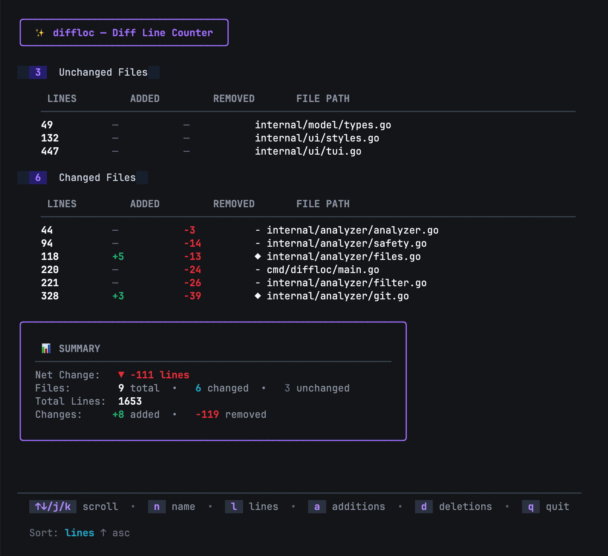

# diffloc
Git diff & line count statistics. Shows line counts, additions, and deletions for your codebase. Works in non-git repos too.

<p align="center">
  
</p>


## Features
- Works in git repos and non-git directories
- Exact per-file additions/deletions from `git diff --numstat` (staged + unstaged vs HEAD)
- Respects .gitignore, nested .gitignore files, `.git/info/exclude` and your global excludes
- Smart filtering for common artifacts
- JSON output mode
- Configurable via file or flags
- Supports all mainstream languages out of the box — Go, Rust, Python, JavaScript/TypeScript, C/C++, JVM, .NET, and more (extensible via [.diffloc.yaml](#config-file))

## Installation
```bash
# Homebrew
brew tap nodelike/tap
brew trust nodelike/tap    # Homebrew 7+ refuses formulas from untrusted taps
brew install diffloc

# Go
go install github.com/nodelike/diffloc/cmd/diffloc@latest
```

## Usage

```bash
diffloc                    # Current directory
diffloc /path/to/project   # Specific path (a repo subdirectory scopes the report to it)
diffloc --json             # JSON output
```

### Flags

| Flag | Description |
|------|-------------|
| `--no-gitignore` | Ignore .gitignore patterns |
| `--exclude-tests` | Exclude test files |
| `--exclude <pattern>` | Custom exclusion regex (repeatable) |
| `--ext <ext>` | Override allowed extensions (repeatable) |
| `--max-depth <n>` | Limit directory depth (0 = unlimited, 1 = top-level files only) |
| `--json` | Output as JSON |
| `--config <file>` | Config file path (default: `.diffloc.yaml`) |

### Config File

Create `.diffloc.yaml` in your project root:

```yaml
exclude-tests: true
no-gitignore: false
max-depth: 0
exclude:
  - "vendor/"
  - "\\.pb\\.go$"
ext:
  - ".go"
  - ".py"
```

Settings can also come from `DIFFLOC_*` environment variables, e.g. `DIFFLOC_EXCLUDE_TESTS=true`. The config file is looked up in the analyzed path, then the current directory.

In git repositories diffloc shells out to `git`, so it needs `git` on your `PATH`. Without it, every directory is counted as a plain directory.

## What Gets Excluded

**Directories:** `node_modules`, `venv`, `.venv`, `__pycache__`, `.git`, `dist`, `build`, `target`, `*.egg-info`, `.tox`, `coverage`, `.next`, `vendor`, `bin`, `tmp`

**Files:** Lock files (`*.lock`, `*-lock.json`), binaries (`*.exe`, `*.so`, `*.dylib`, `*.dll`), images (`*.jpg`, `*.png`, `*.svg`, etc.), generated files (`*_templ.go`, `*.pb.go`, `*.min.js`)

**Default Extensions:** Common source files across mainstream languages, including `.go`, `.rs`, `.py`, `.js`/`.ts`/`.jsx`/`.tsx`, `.vue`/`.svelte`, `.c`/`.cpp`/`.h`/`.hpp`, `.java`/`.kt`/`.scala`, `.cs`/`.fs`, `.swift`, `.rb`, `.php`, `.css`/`.scss`, `.sql`, and more. Override with `--ext` or the config file.


## License

[MIT License](LICENSE)


made with ❤️ by [@nodelike](https://nodelike.com/)
